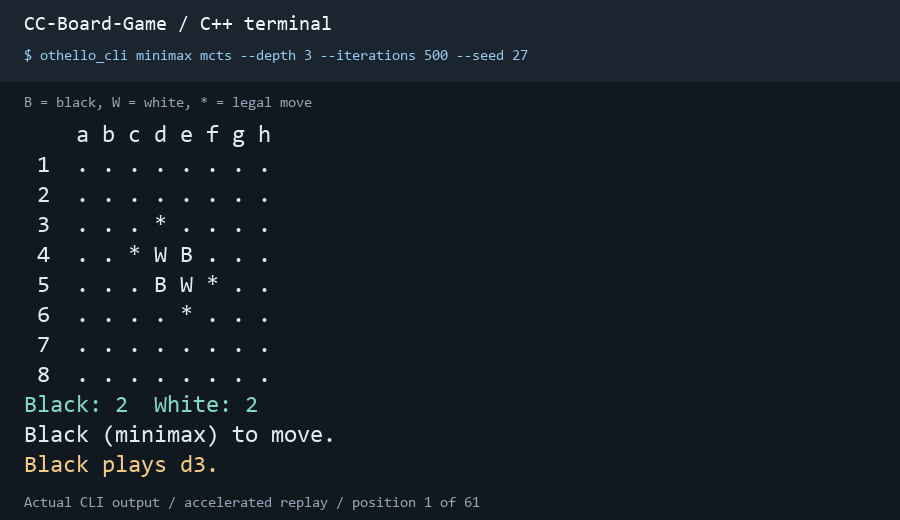
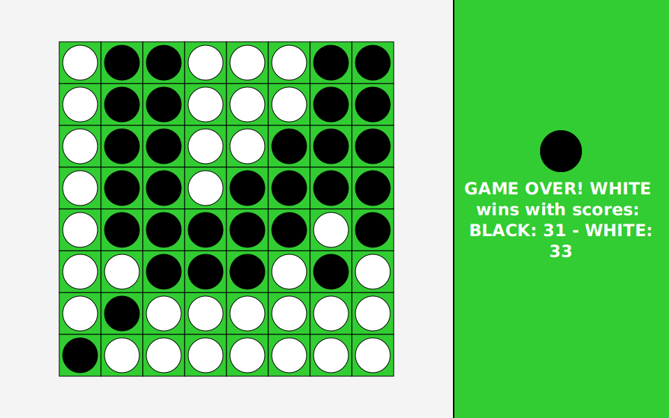

# CC-Board-Game

Othello in Java and C++, with human players, Minimax, and MCTS. The Java version
also includes an experimental TD-learning strategy and trained baseline weights.

## Demo

### C++ terminal

Minimax (black) vs. MCTS (white), replaying actual CLI output at a faster pace.



After building the C++ version, reproduce this game with:

```sh
./.build/cpp/othello_cli minimax mcts --depth 3 --iterations 500 --seed 27
```

[Full terminal transcript](docs/demo/cpp-demo.txt).

### Java desktop

A completed JavaFX human-vs-TD-baseline game. Computer turns are advanced using
the **Take Computer Turn** button.



## Structure

```text
cpp/
  include/ccbg/           Public rules and search interfaces
  src/                    Rules, search, and terminal application
  tests/                  Independent rules oracle and CLI checks
  CMakeLists.txt           C++17 library and executable targets
java/
  src/main/java/othello/   Application, game logic, and JavaFX interface
  src/main/resources/     JavaFX layout
  src/test/java/          JUnit tests
  pom.xml                 Maven build
docs/
  othello-class-diagram.pdf
```

## C++ version

Requires a C++17 compiler and CMake 3.16 or newer. It uses only the standard
library. Run these commands from the repository root:

```sh
cmake -S cpp -B .build/cpp -DCMAKE_BUILD_TYPE=Release
cmake --build .build/cpp --config Release
ctest --test-dir .build/cpp -C Release --output-on-failure
./.build/cpp/othello_cli human mcts --iterations 500 --seed 27
```

For a Visual Studio multi-configuration build on Windows, run
`.\.build\cpp\Release\othello_cli.exe` instead. Use a terminal with your C++
compiler configured.

Player arguments select black and white: `human human`, `human mcts`,
`human minimax`, or `minimax mcts`. Enter a square such as `d3`; `*` marks legal
moves. Passing occurs automatically when required. Enter `quit` to stop.
`--depth` controls Minimax placements, `--iterations` controls MCTS simulations,
and `--seed` makes MCTS repeatable with the same build and settings.

The rules and searches are independent of terminal input/output. A CMake project
can reuse them with:

```cmake
add_subdirectory(path/to/CC-Board-Game/cpp cc-board-game)
target_link_libraries(your_target PRIVATE ccbg::othello)
```

Include `ccbg/othello.hpp` for `Board` and `Game`, and `ccbg/search.hpp` for
`choose_mcts` and `choose_minimax`. `Game::play` switches players;
`Game::pass` is explicit and only allowed when required. Boards serialize to 64
row-major `B`, `W`, or `.` characters; the current player is stored separately.
Both searches return an empty optional when the player must pass and leave the
input board unchanged. The C++ version currently provides local terminal play
and the reusable library; Java's TD-learning model remains in the Java version.

## Java version

Requires JDK 21. Maven is downloaded by the included wrapper.

```sh
cd java
./mvnw test
./mvnw javafx:run -Djavafx.args="human mcts"
```

On Windows, use:

```powershell
cd java
.\mvnw.cmd test
.\mvnw.cmd javafx:run "-Djavafx.args=human mcts"
```

The two arguments select the black and white players:

| Arguments | Mode |
| --- | --- |
| `human human` | Two human players on one board |
| `human minimax` | Human vs. Minimax |
| `human mcts` | Human vs. MCTS |
| `minimax mcts` | Minimax vs. MCTS |
| `human custom` | Human vs. the experimental TD-learning strategy |

Click **Take Computer Turn** to advance a computer player's turn. The `custom`
strategy loads the baseline weights in `java/models/othello-td.zip`.

## TD-learning

The bundled baseline was trained for 20 self-play games with seed 27. Both colors
share one network, learning between consecutive afterstates from the same
player's perspective. Terminal rewards are +1 for a win, 0 for a draw, and -1 for
a loss. Training uses gamma 0.99, Adam learning rate 0.001, and exploration 0.1;
inference disables exploration and does not update weights.

From `java/`, train or continue an existing checkpoint:

```sh
./mvnw compile exec:java -Dexec.args="--games 20 --model models/othello-td.zip --seed 27"
./mvnw javafx:run -Djavafx.args="human custom"
```

Windows:

```powershell
.\mvnw.cmd compile exec:java "-Dexec.args=--games 20 --model models/othello-td.zip --seed 27"
.\mvnw.cmd javafx:run "-Djavafx.args=human custom"
```

Each completed game saves a checkpoint. An existing model is resumed; a new model
path starts from seeded initial weights. To play with a different checkpoint, add
`-Dothello.model=path/to/model.zip` (quote the entire argument in PowerShell).
Twenty games validate the training workflow; playing strength needs separate
evaluation.

The default test run excludes the training-loop checks in `TestLearningTrain`.
Run those checks separately with:

```sh
./mvnw -Ptraining-tests test
```

GUI integration checks load the JavaFX window and play complete games. They
require a desktop display and run separately from the default unit tests:

```sh
./mvnw -Dtest=othello.gui.OthelloGuiIT test
```

On Windows: `.\mvnw.cmd "-Dtest=othello.gui.OthelloGuiIT" test`.
