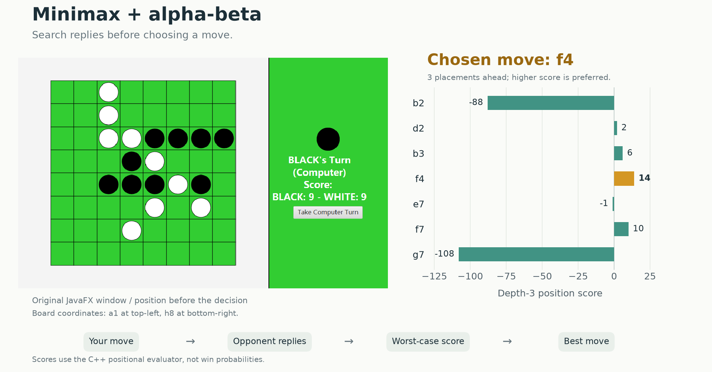
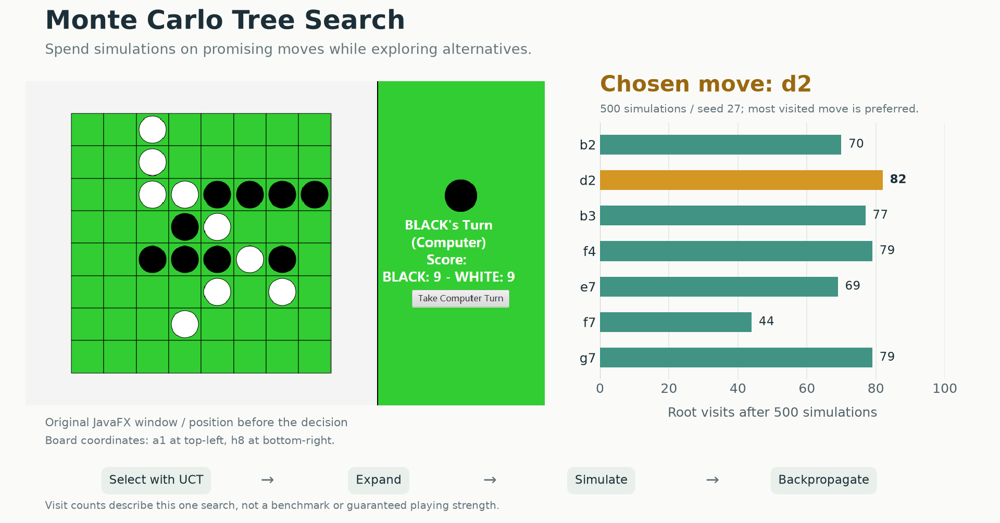
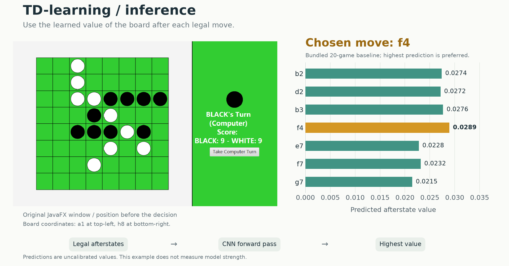

# CC-Board-Game

Othello in Java and C++. Play against Minimax, MCTS, or the Java TD-learning baseline.

## Same position, three decisions

Each figure shows the same black-to-move position in the **original JavaFX
interface**, next to the values used to choose a move. The gold bar marks the
choice. Minimax and MCTS use the C++ implementation; TD-learning uses the
bundled Java model.

### Minimax: look ahead

Search three placements ahead, account for the opponent's best replies, and
choose the highest resulting position score. Alpha-beta pruning skips branches
that cannot improve the decision. Here, **f4** has the highest score, **14**.



### MCTS: try possible continuations

Use UCT to balance exploration and promising moves, simulate games, and feed the
results back into the tree. After **500 simulations** with seed 27, **d2** has
the most root visits (**82**) and is selected.



### TD-learning: evaluate the next board

Apply each legal move, score its resulting board with the value network, and
choose the highest prediction. The bundled checkpoint was trained for 20
self-play games. Here, it chooses **f4**, with a predicted value of **0.0289**.



The values have different meanings across algorithms. This explains one
decision, not relative playing strength. [Recorded position and values](docs/demo/algorithm-decisions.json).

## Run it

### Java desktop

Requires **JDK 21**. The wrapper downloads Maven and the dependencies.

```sh
cd java
./mvnw test
./mvnw javafx:run -Djavafx.args="human mcts"
```

On Windows, use `.\mvnw.cmd test` and
`.\mvnw.cmd javafx:run "-Djavafx.args=human mcts"`.

The two arguments select black and white: `human human`, `human minimax`,
`human mcts`, or `minimax mcts`. Java also accepts `human custom` to play against
the bundled TD model. Click **Take Computer Turn** to advance a computer player.

### C++ terminal

Requires a **C++17 compiler** and **CMake 3.16+**. Run from the repository root:

```sh
cmake -S cpp -B .build/cpp -DCMAKE_BUILD_TYPE=Release
cmake --build .build/cpp --config Release
ctest --test-dir .build/cpp -C Release --output-on-failure
./.build/cpp/othello_cli human mcts --iterations 500 --seed 27
```

For a Visual Studio build on Windows, run `.\.build\cpp\Release\othello_cli.exe`.
Enter a square such as `d3`, or `quit` to stop. Passing is automatic when required.
Choose `human`, `minimax`, or `mcts` for either player; `--depth` sets the Minimax
placement depth and `--iterations` sets the MCTS simulation count.


Minimax plays black, MCTS plays white. This is an accelerated replay of
[actual CLI output](docs/demo/cpp-demo.txt).

<details>
<summary>Train the Java model and run extra checks</summary>

From `java/`, train a new model or continue an existing checkpoint:

```sh
./mvnw compile exec:java -Dexec.args="--games 20 --model models/othello-td.zip --seed 27"
./mvnw javafx:run -Djavafx.args="human custom"
```

On Windows, use `.\mvnw.cmd` and quote the whole `-D` argument, for example
`"-Dexec.args=--games 20 --model models/othello-td.zip --seed 27"`.

Each completed game saves a checkpoint. The baseline's settings and checksum
are in [othello-td.json](java/models/othello-td.json). To load another checkpoint,
add `-Dothello.model=path/to/model.zip`.

The default unit tests exclude the full training-loop checks. Run those, or the
GUI checks that play complete games, separately:

```sh
./mvnw -Ptraining-tests test
./mvnw -Dtest=othello.gui.OthelloGuiIT test
```

GUI checks require a desktop display. Twenty self-play games provide a small
training baseline; its playing strength has not been measured.

</details>

<details>
<summary>Use the C++ engine in another application</summary>

The rules and searches use only the standard library and are separate from
terminal input/output.

```cmake
add_subdirectory(path/to/CC-Board-Game/cpp cc-board-game)
target_link_libraries(your_target PRIVATE ccbg::othello)
```

Include `ccbg/othello.hpp` for `Board` and `Game`, and `ccbg/search.hpp` for
`choose_minimax` and `choose_mcts`. Searches leave the input board unchanged and
return an empty optional when the player must pass. `Game::play` switches turns;
`Game::pass` is explicit and allowed only when required.

Boards serialize to 64 row-major `B`, `W`, or `.` characters. Store the current
player separately. TD-learning remains in the Java implementation.

</details>
